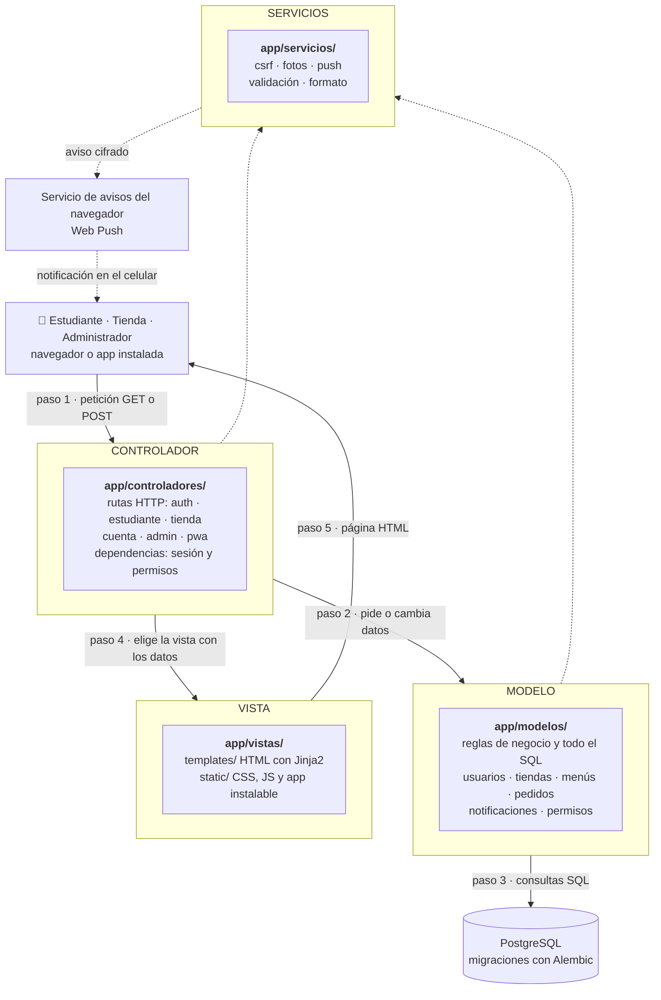
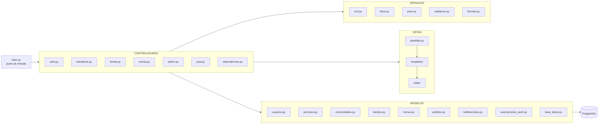
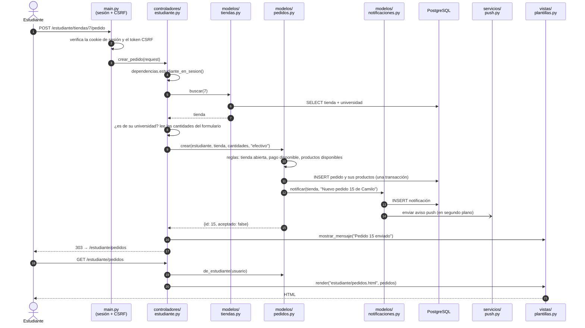
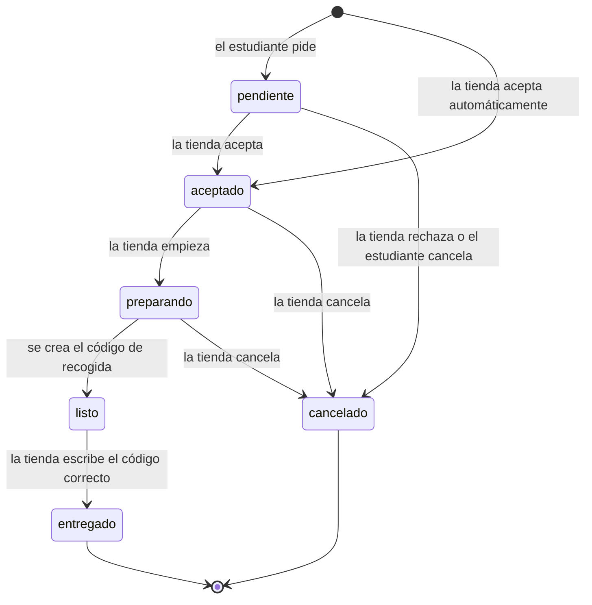
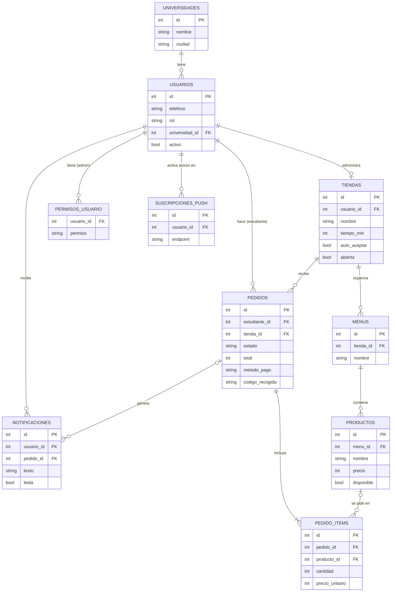
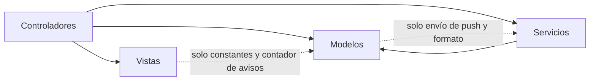

# Arquitectura de Bee

Bee sigue el patrón **Modelo-Vista-Controlador (MVC)** sobre FastAPI, PostgreSQL y plantillas Jinja2. Este documento explica cómo está organizado el código, cómo viaja una petición por las capas y qué reglas mantienen esa separación.

- [1. Vista general](#1-vista-general)
- [2. Las capas y sus módulos](#2-las-capas-y-sus-módulos)
- [3. Estructura de carpetas](#3-estructura-de-carpetas)
- [4. Cómo viaja una petición](#4-cómo-viaja-una-petición)
- [5. Ciclo de vida de un pedido](#5-ciclo-de-vida-de-un-pedido)
- [6. Modelo de datos](#6-modelo-de-datos)
- [7. Rutas por controlador](#7-rutas-por-controlador)
- [8. Reglas de dependencia (y cómo se hacen cumplir)](#8-reglas-de-dependencia-y-cómo-se-hacen-cumplir)
- [9. Cómo agregar una funcionalidad](#9-cómo-agregar-una-funcionalidad)
- [10. Decisiones de diseño](#10-decisiones-de-diseño)

---

## 1. Vista general



| Capa | Carpeta | Responsabilidad | No debe |
|---|---|---|---|
| **Modelo** | `app/modelos/` | Datos (todo el SQL) y reglas de negocio: estados de un pedido, horario de una tienda, permisos, código de recogida. | Conocer HTTP, sesiones o plantillas. |
| **Vista** | `app/vistas/` | Lo que ve el usuario: plantillas HTML, estilos, JavaScript y archivos de la app instalable. | Consultar la base de datos ni decidir permisos. |
| **Controlador** | `app/controladores/` | Recibir la petición, validar lo escrito por el usuario, llamar al modelo y elegir la vista. | Escribir SQL. |
| **Servicios** | `app/servicios/` | Apoyo transversal: seguridad de formularios (CSRF), procesamiento de fotos, avisos push, validación y formato. | Contener reglas del negocio. |

`main.py` es el **punto de entrada**: crea la aplicación, registra los controladores, el middleware de sesión y la protección CSRF, y aplica las migraciones al arrancar. `app/config.py` concentra la configuración (variables de entorno, rutas y constantes).

---

## 2. Las capas y sus módulos



### Modelos (`app/modelos/`)

| Módulo | Qué contiene |
|---|---|
| `base_datos.py` | Conexión a PostgreSQL, atajos `uno()`, `todos()`, `ejecutar()` y `aplicar_migraciones()`. |
| `usuarios.py` | Roles, crear usuarios (con su tienda o permisos), datos, foto, suspender y eliminar; búsqueda para el administrador. |
| `permisos.py` | Los 7 permisos de administrador y sus reglas: nadie da permisos que no tiene. |
| `universidades.py` | Listar, crear y contar estudiantes y tiendas por universidad. |
| `tiendas.py` | Horario (abierta o cerrada, incluso pasando la medianoche), tiempos de preparación y tiendas de una universidad. |
| `menus.py` | Menús y productos de una tienda: precios, disponibilidad y fotos. Solo afecta a la tienda dueña. |
| `pedidos.py` | Estados y transiciones, métodos de pago, código de recogida y las operaciones crear, cambiar estado, entregar y cancelar. |
| `notificaciones.py` | La campana: crear, contar y marcar avisos como leídos. También dispara el aviso push. |
| `suscripciones_push.py` | Celulares que reciben avisos push de cada usuario. |

### Vistas (`app/vistas/`)

| Elemento | Qué contiene |
|---|---|
| `plantillas.py` | Configura Jinja2 (filtros como `pesos` y `hora`, y funciones globales) y ofrece `render()` y `mostrar_mensaje()`. |
| `templates/layouts/` | Bases: `base.html` (todas), `auth_base.html` (login y registro), `app_base.html` (con sesión; diseño de app con barra inferior para el estudiante). |
| `templates/parciales/` | Piezas reutilizables: avatar, íconos, mensajes, campos de formulario, tarjeta de avisos. |
| `templates/auth/`, `cuenta/`, `estudiante/`, `tienda/`, `admin/`, `pwa/`, `errores/` | Una carpeta de vistas por controlador. |
| `static/` | `styles.css`, `avisos.js` (campana), `push.js` (activar avisos) y `pwa/` (manifest, service worker e íconos). |

### Controladores (`app/controladores/`)

| Módulo | Usuario | Qué maneja |
|---|---|---|
| `auth.py` | Todos | Portada, registro, inicio de sesión con código, completar perfil. |
| `estudiante.py` | Estudiante | Tiendas de su universidad, pedir, «pedir de nuevo», seguir y cancelar pedidos. |
| `tienda.py` | Tienda | Tablero de pedidos, entregar con código, abrir/cerrar, horario, menús y productos. |
| `cuenta.py` | Todos | Avisos, configuración del perfil, fotos, eliminar cuenta. |
| `admin.py` | Administrador | Usuarios, permisos, pedidos de todas las tiendas, universidades. |
| `pwa.py` | Todos | App instalable (`/app`, manifest, service worker, `/instalar`) y suscripción a avisos push. |
| `dependencias.py` | — | `usuario_en_sesion`, `estudiante_en_sesion`, `tienda_en_sesion`, `requiere_permiso(...)`. |

### Servicios (`app/servicios/`)

| Módulo | Qué hace |
|---|---|
| `csrf.py` | Token secreto en cada formulario; `main.py` lo exige en todo POST. |
| `fotos.py` | Valida imágenes y las convierte en JPEG cuadrado. |
| `push.py` | Claves VAPID y envío de notificaciones push cifradas, en segundo plano. |
| `validacion.py` | Clase `Formulario`: lee campos y acumula errores para mostrarlos junto a cada campo. |
| `formato.py` | Formatos para mostrar, por ejemplo `pesos(12500)` → `$12.500`. |

---

## 3. Estructura de carpetas

```text
BEE/
├── main.py                     Punto de entrada: arma la app con sus capas
├── app/
│   ├── config.py               Configuración (.env, rutas, constantes)
│   ├── modelos/                M · datos y reglas de negocio (todo el SQL)
│   ├── vistas/                 V · lo que ve el usuario
│   │   ├── plantillas.py           motor Jinja2 y render()
│   │   ├── templates/              HTML: layouts/, parciales/ y una carpeta por controlador
│   │   └── static/                 CSS, JavaScript y app instalable (pwa/)
│   ├── controladores/          C · rutas HTTP (sin SQL)
│   └── servicios/              Apoyo: CSRF, fotos, push, validación, formato
├── migraciones/                Cambios de la base de datos en orden (Alembic)
├── tests/                      Pruebas automáticas (incluye pruebas de arquitectura)
├── scripts/                    Herramientas: primer administrador, claves push, diccionario
├── docs/                       Página de presentación (GitHub Pages) y diccionario de datos
├── .github/workflows/          Pruebas automáticas en cada pull request
├── alembic.ini · render.yaml   Configuración de migraciones y de publicación
└── requirements.txt            Dependencias de Python
```

Cada carpeta de capa tiene su propio `README.md` con más detalle. Los diagramas de este documento también están como imágenes SVG en [`docs/arquitectura/`](docs/arquitectura/), listas para presentaciones.

---

## 4. Cómo viaja una petición

Ejemplo: un estudiante confirma su pedido.



Si una regla falla (por ejemplo, la tienda está cerrada), el modelo lanza `PedidoInvalido("… está cerrada")`, el controlador muestra ese mensaje y devuelve al estudiante al menú. El modelo decide **qué** está permitido; el controlador decide **qué mostrar**.

---

## 5. Ciclo de vida de un pedido

Las transiciones están en `app/modelos/pedidos.py` (`TRANSICIONES`) y el modelo rechaza cualquier cambio que no esté en esa tabla.



Cada cambio crea una notificación para la otra parte (campana y aviso push al celular).

---

## 6. Modelo de datos

Tablas en PostgreSQL, creadas con las migraciones de `migraciones/versiones/`. El diccionario completo, con la descripción de cada campo, está en [`docs/diccionario.html`](docs/diccionario.html).



**Migraciones:** `0001` aplica el esquema inicial (idempotente, conserva los datos existentes), `0002` agrega el horario, el método de pago y las fotos de productos, y `0003` agrega el código de recogida y las suscripciones push. Los cambios nuevos siempre van en una migración nueva (ver README, «Migraciones»).

---

## 7. Rutas por controlador

| Controlador | Rutas |
|---|---|
| `auth.py` | `GET /` · `GET /registro` · `POST /registrar` · `GET,POST /login` · `POST /verificar-codigo` · `GET /logout` · `GET,POST /completar-perfil` |
| `estudiante.py` | `GET /estudiante` · `GET /estudiante/tiendas/{id}` · `POST /estudiante/tiendas/{id}/pedido` · `GET /estudiante/pedidos` · `POST /estudiante/pedidos/{id}/cancelar` |
| `tienda.py` | `GET /tienda` · `POST /tienda/pedidos/{id}/estado` · `POST /tienda/entregar` · `POST /tienda/disponibilidad` · `POST /tienda/abrir-cerrar` · `GET /tienda/menu` · `POST /tienda/menus` · `POST /tienda/menus/{id}/eliminar` · `POST /tienda/menus/{id}/productos` · `POST /tienda/productos/{id}/editar · /disponibilidad · /eliminar · /foto · /foto/eliminar` |
| `cuenta.py` | `GET /notificaciones` · `GET /notificaciones/resumen` · `POST /notificaciones/leidas` · `GET /configuracion` · `POST /configuracion/perfil · /foto · /foto/eliminar · /cerrar-cuenta` · `GET /fotos/{id}` · `GET /productos/{id}/foto` |
| `admin.py` | `GET /admin` · `GET /admin/usuarios` · `GET /admin/usuarios/nuevo` · `POST /admin/usuarios` · `GET /admin/usuarios/{id}` · `POST /admin/usuarios/{id}/datos · /permisos · /estado · /eliminar` · `GET /admin/pedidos` · `GET,POST /admin/universidades` |
| `pwa.py` | `GET /app` · `GET /manifest.webmanifest` · `GET /sw.js` · `GET /instalar` · `GET /offline` · `GET /push/clave` · `POST /push/suscribir` · `POST /push/desuscribir` |

En total son **58 rutas**. La documentación interactiva generada por FastAPI está en `http://127.0.0.1:8000/docs` con la app corriendo.

---

## 8. Reglas de dependencia (y cómo se hacen cumplir)



| Regla | Prueba que la verifica (`tests/test_arquitectura.py`) |
|---|---|
| Los controladores **no tienen SQL** y no abren la base de datos directamente. | `test_los_controladores_no_tienen_sql`, `test_los_controladores_no_abren_la_base_de_datos` |
| Los modelos **no conocen HTTP** (FastAPI, Starlette) ni importan vistas o controladores. | `test_los_modelos_no_conocen_http_ni_las_vistas` |
| Las vistas no usan controladores ni escriben SQL. | `test_las_vistas_no_usan_controladores_ni_sql` |
| No hay archivos sueltos en `app/`: cada módulo está en su capa. | `test_estructura_mvc` |

Estas pruebas corren en cada pull request (GitHub Actions). Si alguien rompe la separación, el pull request aparece en rojo.

---

## 9. Cómo agregar una funcionalidad

Ejemplo: «la tienda puede marcar un producto como recomendado».

1. **Base de datos:** crea una migración (`alembic revision -m "producto recomendado"`) con el `ALTER TABLE` y su `COMMENT`.
2. **Modelo:** en `app/modelos/menus.py`, agrega `alternar_recomendado(tienda_id, producto_id)` con el SQL y la regla de que solo afecte a la tienda dueña.
3. **Controlador:** en `app/controladores/tienda.py`, agrega `POST /tienda/productos/{id}/recomendado`, que llama al modelo y muestra el mensaje.
4. **Vista:** en `app/vistas/templates/tienda/menu.html`, agrega el botón (con `{{ campo_csrf() }}` dentro del formulario) y, si hace falta, estilos en `static/styles.css`.
5. **Pruebas:** agrega una prueba en `tests/` y ejecuta `pytest`. Las pruebas de arquitectura confirman que respetaste las capas.
6. **Documentación:** si cambiaste la base de datos, ejecuta `python scripts/generar_diccionario.py`.

---

## 10. Decisiones de diseño

| Decisión | Por qué |
|---|---|
| **Modelos como módulos de funciones** (no clases ORM) | El dominio es pequeño y el SQL explícito es fácil de leer y de explicar. Cada módulo agrupa los datos de una entidad, como haría una clase. Si el proyecto crece, se pueden envolver en clases sin tocar controladores ni vistas. |
| **SQL directo con psycopg** (sin ORM) | Control total de las consultas (transacciones `FOR UPDATE`, `RETURNING`, filtros por tienda dueña) y menos dependencias. |
| **Vistas renderizadas en el servidor** (Jinja2) | Funciona sin JavaScript, es rápido en celulares y escapa el HTML automáticamente (protección contra XSS). JavaScript solo agrega comodidad: carrito, campana, avisos. |
| **Migraciones con Alembic** | Cada cambio de la base queda versionado; la app se pone al día sola al arrancar. |
| **Seguridad en capas** | Sesión en cookie firmada, token CSRF en todo POST, el teléfono a verificar se guarda en la sesión, permisos verificados en el servidor y reglas de pertenencia (una tienda solo modifica sus propios productos). |
| **App instalable (PWA)** en lugar de app nativa | Un solo código para web, Android e iPhone, sin tiendas de aplicaciones. Los avisos push son gratis (Web Push). |
| **Pruebas de arquitectura** | La separación MVC no depende de la memoria del equipo: se verifica automáticamente. |
